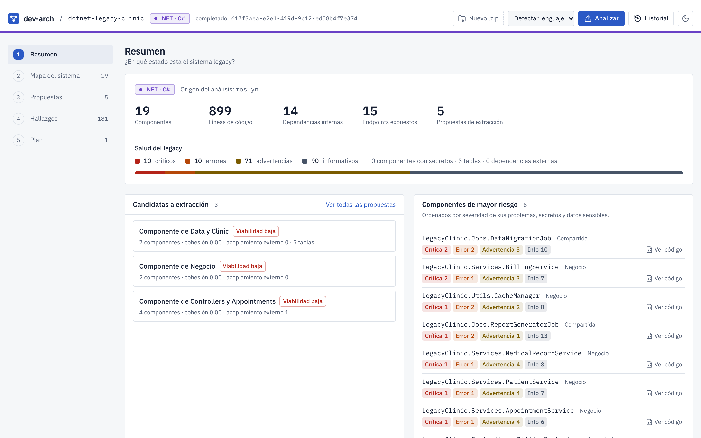
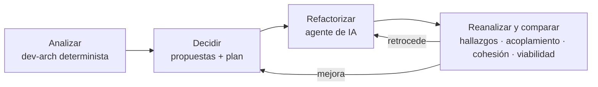
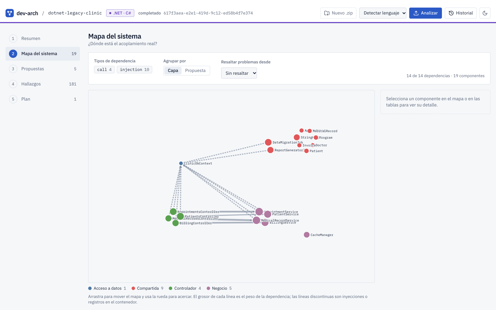
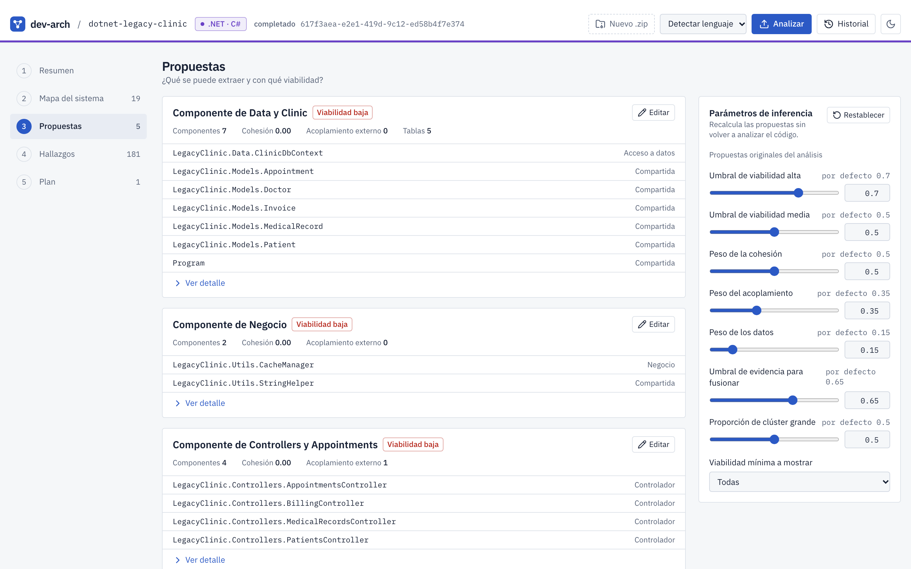
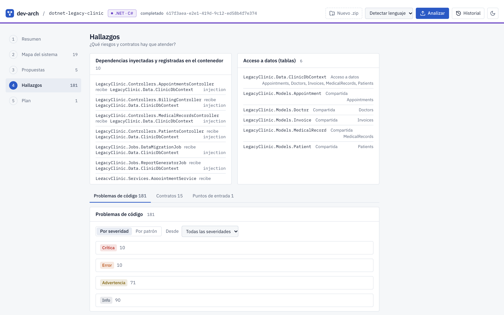
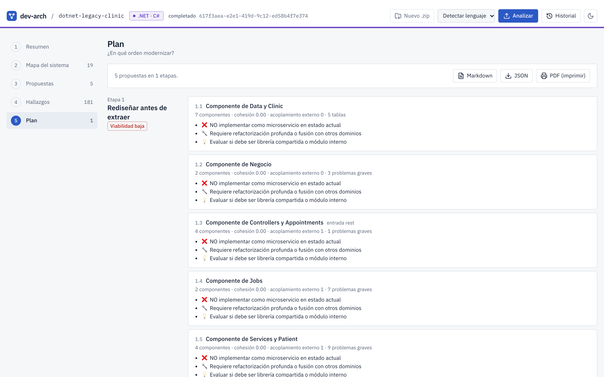
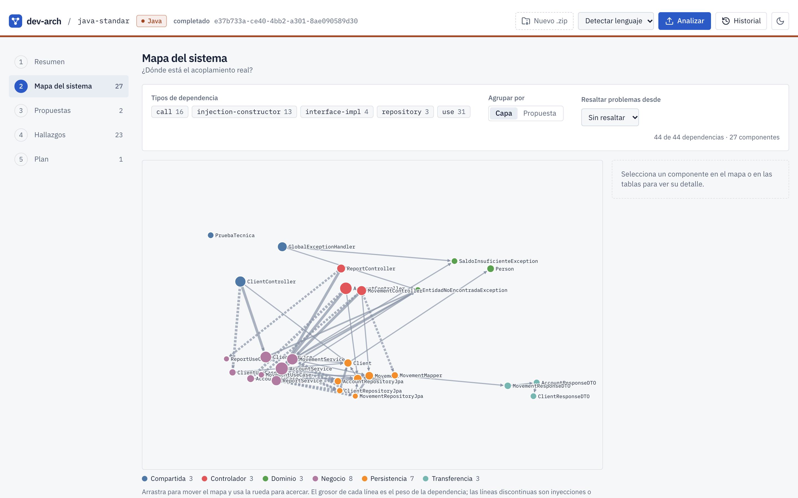
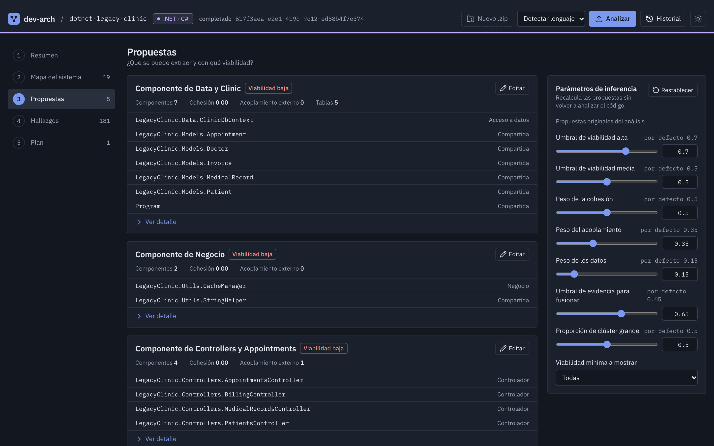

<p align="center"></p>

<h1 align="center">dev-arch</h1>

<p align="center"><b>Análisis estático determinista para modernizar sistemas legacy Java y .NET<br>— la base de verdad sobre la que la IA puede refactorizar sin inventar.</b></p>

<p align="center">
  <a href="https://github.com/raalzate/dev-arch/actions/workflows/dev-arch.yml"></a>
  
  
  <a href="docs/EVALUATIONS.md#1-determinismo-y-reproducibilidad"></a>
  <a href="docs/EVALUATIONS.md#4-batería-de-pruebas"></a>
  <a href="docs/EVALUATIONS.md"></a>
</p>
<p align="center">
  
  
  
  
  <a href="docs/AGENTS-MCP.md"></a>
  <a href="#b-instalación-con-docker"></a>
</p>

<p align="center">
  
</p>

<p align="center"><a href="#instalación"><b>Instalación</b></a> · <a href="#la-tesis">La tesis</a> · <a href="#qué-muestra">Qué muestra</a> · <a href="docs/AGENTS-MCP.md">Conectar un agente</a> · <a href="docs/EVALUATIONS.md">Evaluaciones</a></p>

---

## La tesis

> **Los modelos de IA pueden refactorizar, pero solo un modelo de inferencia determinista sabe cómo está el
> proyecto sin inventar. Para modernizar hay que apalancarse en él: es la fuente de verdad del estado del sistema y,
> ejecutado en cada cambio, el guardrail que mantiene principios y buenas prácticas. Eso es lo que hace posible la
> modernización continua.**

### 1. La IA generativa refactoriza; no es fuente de verdad

Un modelo de lenguaje es excelente escribiendo y transformando código, pero cuando se le pregunta *cómo está* un
sistema grande responde con una estimación: lee una parte del código, completa el resto por probabilidad y puede
alucinar dependencias, capas o tablas que no existen. Su respuesta además cambia entre ejecuciones. Para decidir
qué extraer de un monolito eso no alcanza: una decisión de arquitectura apoyada en una descripción inventada es peor
que no tener ninguna.

### 2. La inferencia determinista dice cómo está el proyecto, sin inventar

dev-arch no genera: **mide**. Su motor recorre el árbol sintáctico completo (Spoon para Java, Roslyn para C# y
VB.NET) y construye el grafo real de dependencias, las capas, las tablas que toca cada componente, los contratos
REST, los secretos expuestos y los problemas de código. Sobre ese grafo aplica un algoritmo de inferencia con
pesos y umbrales explícitos (cohesión, acoplamiento, datos compartidos) para proponer microservicios con su
viabilidad.

- **Reproducible:** misma entrada, misma salida, byte a byte, también entre máquinas (lo verifican las pruebas de
  contrato en cada ejecución de la CI; ver [evaluaciones](docs/EVALUATIONS.md#1-determinismo-y-reproducibilidad)).
- **Explicable:** cada propuesta trae sus métricas, sus señales y su justificación; nada es una caja negra.
- **Contrato versionado:** las salidas cumplen un esquema JSON versionado (`schema/1.0.0`) que consumen la web,
  el CLI y los agentes por igual.
- **Ajustable sin reanalizar:** los umbrales de inferencia se cambian y las propuestas se recalculan sobre el mismo
  grafo.

### 3. La IA + el análisis determinista: cada uno en su papel

El agente (por ejemplo Claude Code) usa dev-arch como servidor MCP: **envía** el proyecto, **recibe** el análisis
estructurado y razona sobre hechos, no sobre suposiciones. El modelo decide *cómo* refactorizar; dev-arch le dice
*qué hay* y *si quedó mejor*.

<p align="center">
  
  <br><sub>Sesión real de Claude Code (<code>claude -p</code>) usando dev-arch por MCP: envía la carpeta, recibe propuestas y hallazgos, y el enlace para abrir el mismo análisis en la web.</sub>
</p>

### 4. Guardrail y modernización continua

Como el análisis es determinista, **dos análisis se pueden comparar**. Ejecutado en cada cambio —en la CI o por el
agente después de cada refactorización— se convierte en un guardrail objetivo: no deja que aumenten los
hallazgos críticos, que crezca el acoplamiento, que baje la cohesión ni que una propuesta pierda viabilidad. Los
principios y las buenas prácticas dejan de depender de una revisión manual y pasan a medirse en cada paso.



Ese bucle —**analizar, refactorizar con IA, reanalizar y comparar**— es la **modernización continua**: el sistema
se moderniza por pasos pequeños y verificables, en lugar de una reescritura a ciegas. Más detalle en
[docs/CONTINUOUS-MODERNIZATION.md](docs/CONTINUOUS-MODERNIZATION.md).

---

## Qué muestra

El recorrido de la web responde cinco preguntas, siempre sobre el mismo análisis determinista:

| Paso | Pregunta | |
|---|---|---|
| **1. Resumen** | ¿En qué estado está el sistema legacy? |  |
| **2. Mapa del sistema** | ¿Dónde está el acoplamiento real? |  |
| **3. Propuestas** | ¿Qué se puede extraer y con qué viabilidad? |  |
| **4. Hallazgos** | ¿Qué riesgos y contratos hay que atender? |  |
| **5. Plan** | ¿En qué orden modernizar? |  |

<details><summary>Más capturas: mapa de un proyecto Java y tema oscuro</summary>




</details>

Lenguajes: **Java** (Maven/Gradle, Spring, JEE), **C#** y **VB.NET** (incluido .NET Framework 4.8 legacy).

## Instalación

Hay dos formas de instalar dev-arch. Elige una:

| | **A. Local** (desarrollo) | **B. Docker** (solo usarlo) |
|---|---|---|
| Necesitas | JDK 17, Maven 3.6+, .NET SDK 8 (con runtime 8), Node 20+ | Docker 24+ con Compose v2 (o Podman) |
| Tiempo | ~5 min de compilación | ~5 min la primera vez (construye la imagen) |
| Para | modificar el código, correr las pruebas | analizar proyectos y conectar agentes |

En ambos casos empieza clonando el repositorio:

```bash
git clone https://github.com/raalzate/dev-arch.git
cd dev-arch
```

### A. Instalación local

**1. Revisa los requisitos.** El diagnóstico lista cada requisito con `OK`, `WARN` o `FAIL`, la versión detectada y el
comando de instalación para tu sistema operativo (solo necesita Node 20+):

```bash
npm run doctor            # diagnóstico
npm run doctor -- --fix   # además muestra los comandos para instalar lo que falte (no ejecuta nada)
```

> **.NET SDK 8:** el repositorio fija el SDK 8 (`global.json`) para que el análisis .NET sea reproducible. Si solo
> tienes un SDK más nuevo, todo compila y funciona, pero instala el 8 junto al tuyo para obtener exactamente los
> mismos resultados que la CI ([cómo](docs/INSTALL.md#reproducible-net-analysis-sdk-8)).

**2. Compila** el motor Java, el analizador .NET y la web:

```bash
make build
```

**3. Arranca la web:**

```bash
make dev                  # http://localhost:9002
```

### B. Instalación con Docker

```bash
docker compose -f docker/compose.yaml up -d     # construye la imagen y arranca en http://127.0.0.1:9002
docker compose -f docker/compose.yaml ps        # debe aparecer "healthy"
```

Para detenerlo: `docker compose -f docker/compose.yaml down`. Con Podman, usa `podman compose` con los mismos
argumentos. La imagen trae el motor y el runtime .NET; los proyectos .NET se analizan en modo de resolución
reducida (no incluye el SDK).

### Comprueba que funciona

```bash
curl http://127.0.0.1:9002/api/health    # "status": "OK" o "WARN"; "FAIL" indica qué falta
```

Abre **http://127.0.0.1:9002**, sube el ZIP de un proyecto Java o .NET (o prueba con un proyecto de ejemplo:
`cd engine/test-for-demo && zip -r ~/java-standar.zip java-standar`) y recorre los cinco pasos.

Opcional: las funciones de IA de la web (documentación generada) usan `GEMINI_API_KEY`. El análisis estático, el
recorrido y el MCP funcionan sin ella.

### Conecta Claude Code (o cualquier agente MCP)

Con dev-arch en marcha (local o Docker), descarga el puente y regístralo una vez:

```bash
curl -fsSo ~/.dev-arch-mcp.mjs http://127.0.0.1:9002/dev-arch-mcp.mjs
claude mcp add dev-arch -- node ~/.dev-arch-mcp.mjs --url http://127.0.0.1:9002
```

Luego, dentro de Claude Code: *"Analiza este proyecto con dev-arch y dame las propuestas y los hallazgos
críticos"*. Instancias remotas con token y conexión solo por HTTP: [docs/AGENTS-MCP.md](docs/AGENTS-MCP.md).

Más detalle: [instalación completa y solución de problemas](docs/INSTALL.md) ·
[conexión de agentes (MCP)](docs/AGENTS-MCP.md) · [arquitectura](docs/ARCHITECTURE.md) ·
[modernización continua](docs/CONTINUOUS-MODERNIZATION.md) · [contrato JSON](docs/SCHEMA.md) ·
[evaluaciones](docs/EVALUATIONS.md)

## Cómo está hecho

| Área | Qué es |
|---|---|
| `engine/` | Motor determinista: Java 17 + Spoon (Java) y analizador .NET 8 + Roslyn (C#/VB.NET); CLI y servidor MCP por stdio |
| `schema/` | Contrato JSON versionado de todas las salidas, con tipos TypeScript generados |
| `web/` | Next.js: recorrido de modernización, API de análisis asíncronos, servidor MCP para agentes (`/api/mcp`) |
| `docker/` | Imagen todo-en-uno y Compose |
| `specs/` | Especificaciones por feature (001–014) con escenarios BDD bloqueados por hash |

El desarrollo sigue especificación → plan → pruebas BDD bloqueadas → implementación (TDD), bajo los principios de
[CONSTITUTION.md](CONSTITUTION.md): compatibilidad, una sola fuente de lógica, TDD, **determinismo**, errores
claros y huella mínima.

## Licencia y contexto

Proyecto de maestría (modernización de software asistida por IA). Ver [CHANGELOG.md](CHANGELOG.md).
