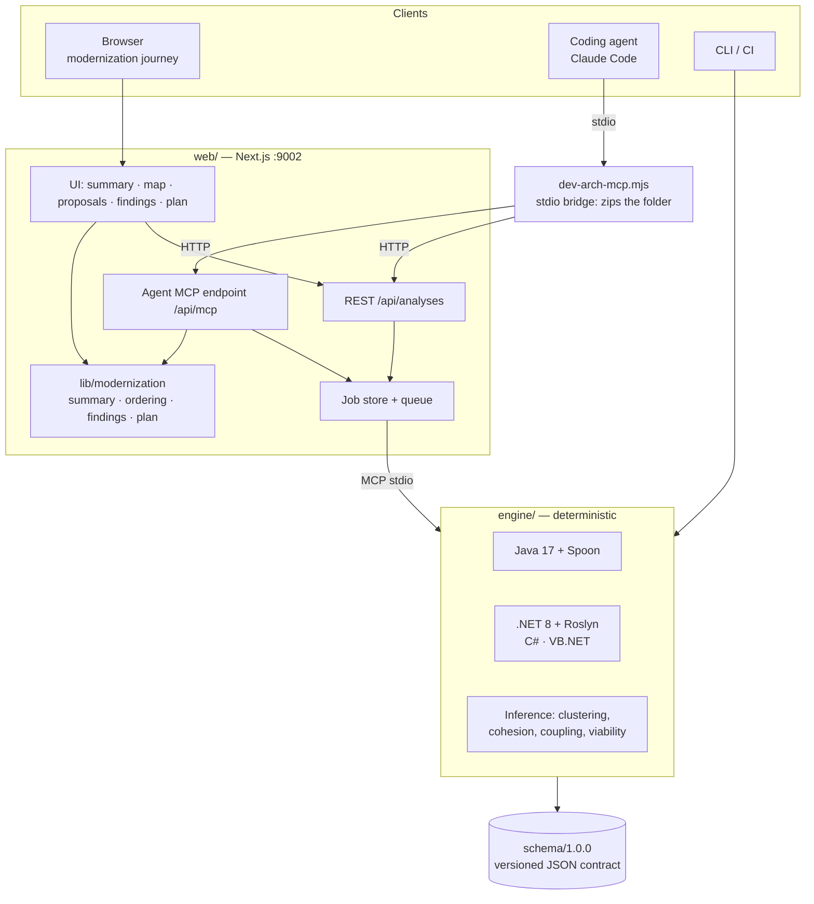

# Architecture

dev-arch is one product with three faces over a single deterministic engine.

| Piece | Responsibility | Deterministic? |
|---|---|---|
| `engine/` (Java + Spoon, .NET + Roslyn) | Parse the whole project, build the dependency graph, detect layers, tables, endpoints, secrets and code issues, infer microservice proposals | Yes: same input, same bytes (contract tests) |
| `schema/` | JSON Schema of every output (`graph`, `architecture`, `contracts`, MCP responses) and generated TypeScript types | — |
| `web/src/lib/modernization` | Pure functions that turn the documents into the five steps (summary, ordering, findings, plan, comparison) | Yes: pure functions |
| `web/src/server` | Asynchronous analyses (upload, queue, store, path redaction, API token), inference re-runs, health | — |
| `web/src/app/api/mcp` | MCP endpoint for agents: the same documents and the same `lib/modernization` functions as the UI | Yes: identical answers for identical requests |
| `web/public/dev-arch-mcp.mjs` | Dependency-free stdio bridge: packages the local folder (deterministic ZIP) and forwards MCP calls | Yes |

Single source of truth: the agent tools, the REST API and the UI all read the same engine documents and project
them with the same functions, so an agent and a person always see the same analysis.

See also: [INSTALL.md](INSTALL.md) · [AGENTS-MCP.md](AGENTS-MCP.md) · [SCHEMA.md](SCHEMA.md) ·
[CONTINUOUS-MODERNIZATION.md](CONTINUOUS-MODERNIZATION.md)
