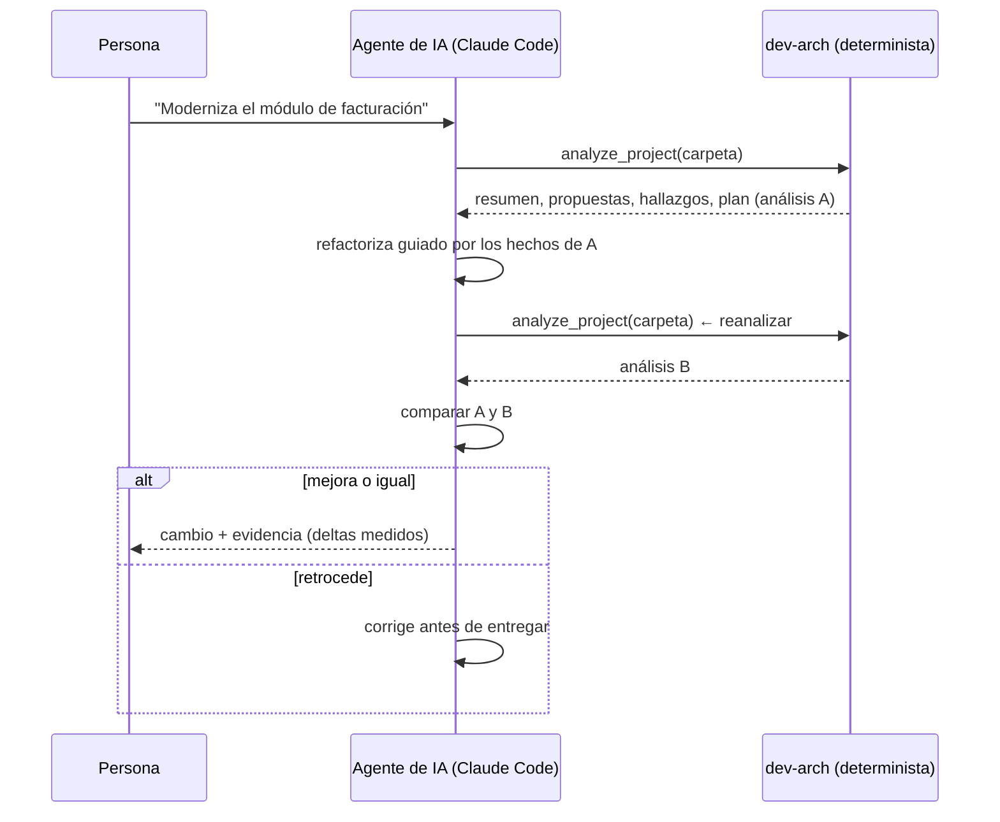

# Modernización continua: IA que refactoriza + análisis determinista que verifica

Este documento desarrolla la tesis de dev-arch: **la IA generativa ejecuta la refactorización; el análisis
determinista dice cómo está el sistema y verifica, en cada paso, que la modernización avanza sin romper principios
ni buenas prácticas.**

## Por qué determinista

| | Modelo generativo (LLM) | Inferencia determinista (dev-arch) |
|---|---|---|
| Qué produce | Texto y código plausibles | Hechos medidos sobre el árbol sintáctico completo |
| Misma entrada dos veces | Puede responder distinto | Misma salida, byte a byte |
| Cobertura | Lo que cabe en el contexto | Todo el proyecto (cada clase, dependencia, tabla y endpoint) |
| Riesgo | Alucinar dependencias, capas o tablas | Ninguna inferencia sin evidencia en el código |
| Papel en la modernización | **Ejecutar** cambios: refactorizar, extraer, reescribir | **Medir** el estado y **verificar** cada cambio |

Un plan de modernización sobre una descripción inventada es frágil; uno sobre un grafo medido es auditable. Por
eso dev-arch no le pregunta a la IA *cómo está* el sistema: se lo dice.

## El bucle

1. **Analizar.** El agente envía el proyecto (`analyze_project`) y recibe el estado real: resumen
   (`get_summary`), propuestas de extracción con su viabilidad (`get_proposals`), hallazgos por severidad
   (`get_findings`) y el plan por etapas (`get_plan`).
2. **Decidir.** Elige el siguiente paso del plan: la propuesta de mayor viabilidad, o el componente de mayor riesgo.
3. **Refactorizar con IA.** El modelo cambia el código: separa responsabilidades, invierte dependencias,
   elimina secretos embebidos, aísla el acceso a datos.
4. **Reanalizar y comparar.** El agente vuelve a analizar y compara el análisis nuevo con el anterior. Como el
   análisis es determinista, cualquier diferencia se debe al cambio, no al azar del modelo.
5. **Aceptar o corregir.** Si los indicadores mejoran o se mantienen, el cambio se entrega con su evidencia; si
   retroceden, el agente corrige antes de entregar.

## Los indicadores que se vigilan

| Indicador | De dónde sale | Regla del guardrail |
|---|---|---|
| **Hallazgos por severidad** (CRITICAL, ERROR, WARNING, INFO) | `get_summary` → `severity`; `get_findings` | Los CRITICAL y ERROR no aumentan |
| **Acoplamiento** (externo de cada propuesta, dependencias internas) | `get_proposals` → `metrics.external_coupling`; `edges` del resumen | No crece en las propuestas tocadas |
| **Cohesión** (interna de cada propuesta) | `get_proposals` → `metrics.cohesion_avg` | No baja en las propuestas tocadas |
| **Viabilidad** de extracción (Alta, Media, Baja) | `get_proposals` → `viability` | Ninguna propuesta baja de nivel |
| **Secretos** y **datos sensibles** | `get_summary` → `componentsWithSecrets`, `sensitiveProposals` | No aparecen secretos nuevos |

La web compara dos análisis del historial (Historial → marcar dos → Comparar) con los mismos totales: componentes,
líneas, dependencias, propuestas por viabilidad y hallazgos por severidad.

## Dónde se ejecuta el guardrail

- **En el agente**, después de cada refactorización: conectado por MCP ([AGENTS-MCP.md](AGENTS-MCP.md)), el agente
  reanaliza y compara antes de dar el cambio por terminado. Una instrucción útil para el agente:
  *"Antes de terminar, vuelve a analizar con dev-arch y confirma que no aumentaron los hallazgos CRITICAL/ERROR ni
  bajó la viabilidad de ninguna propuesta."*
- **En la CI**, en cada cambio: el motor corre sin infraestructura (un JAR y el analizador .NET) y produce el mismo
  JSON que la web, así que un paso de la CI puede analizar la rama, compararla con la de `main` y bloquear el
  merge si los indicadores retroceden.
- **En la revisión humana:** la web muestra el mismo análisis con mapa, propuestas y plan, para que la persona
  decida con la misma evidencia que usó el agente.

## Qué queda fuera

dev-arch no decide por la persona ni reescribe código: mide y propone. La viabilidad y las propuestas son
inferencias sobre la estructura (con pesos y umbrales explícitos y ajustables en el panel de parámetros), no un
juicio de negocio. Los resultados son tan completos como el código analizado: lo que se genera en tiempo de
ejecución o vive fuera del repositorio (configuración externa, reflexión dinámica) se reporta como advertencia,
nunca se inventa.
