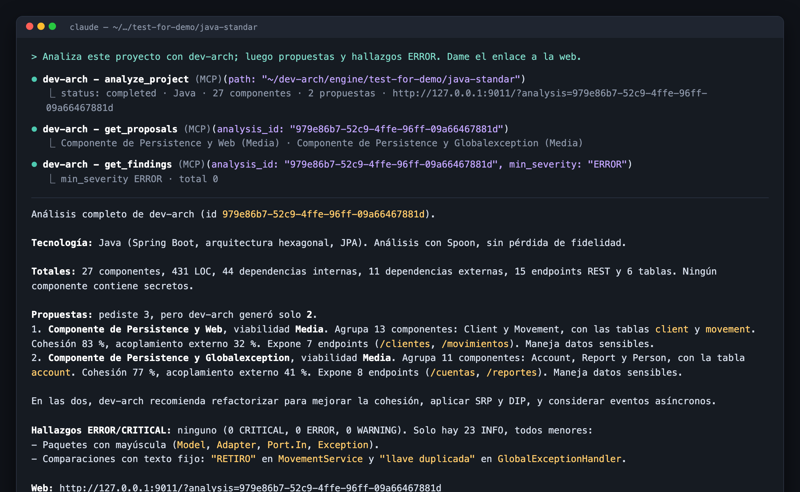

# Evaluaciones

Esta página reúne las evaluaciones hechas sobre dev-arch, con sus datos reales: qué se midió, cómo, con qué
resultado y qué se encontró. Respalda la tesis del proyecto (ver [README](../README.md#la-tesis)): una
modernización asistida por IA es confiable cuando se apoya en un análisis **determinista**, que dice cómo está
el sistema sin inventar y que puede repetirse y compararse en cada cambio.

Fecha de las mediciones: 2026-10-24 · versión del producto `1.2.0` · contrato `schema/1.0.0`.

---

## 1. Determinismo y reproducibilidad

**Pregunta:** ¿la misma entrada produce la misma salida, en ejecuciones distintas y en máquinas distintas?

### 1.1 Misma máquina, dos ejecuciones

Cada proyecto de demostración se analizó dos veces con el motor (CLI) y se compararon los documentos generados
(`output.json`, `output_architecture.json`, `output_entrypoints.json`) con SHA-256.

| Proyecto | Tecnología | Ejecución 1 vs 2 |
|---|---|---|
| `java-standar` | Java (Spoon) | idénticas |
| `jee-architecture-master` | Java EE (Spoon) | idénticas |
| `legacy-erp` | Java legacy (Spoon) | idénticas |
| `dotnet-ecommerce` | .NET C# (Roslyn) | idénticas |
| `dotnet-legacy-clinic` | .NET C# (Roslyn) | idénticas |
| `dotnet-unstructured` | .NET C# sin solución en la raíz | idénticas (ver hallazgo BUG-013) |

Además, la CI verifica en cada cambio que dos ejecuciones sean byte a byte iguales
(`SchemaVersionContractTest.twoRunsAreByteIdentical`) y que la salida coincida con las líneas base versionadas
(`BaselineParityTest`, `DefaultOutputsRegressionTest`).

### 1.2 Máquinas distintas

La primera ejecución de la CI en GitHub (Linux) comparó sus salidas con las líneas base capturadas en macOS y
encontró **dos dependencias del entorno** que el análisis local no podía ver. Las dos se corrigieron:

| Hallazgo | Causa | Corrección | Verificación |
|---|---|---|---|
| **BUG-008** — `CBO promedio 1,9` en macOS (español) y `1.9` en Linux (inglés) | formato numérico con el locale por defecto de la JVM | locale fijo para el texto de justificación | `LocaleIndependenceTest`: misma arquitectura con locale `en-US` y `es-CO` |
| **BUG-009** — `ControllerBase` sin resolver en macOS, `Microsoft.AspNetCore.Mvc.ControllerBase` en Linux | la resolución semántica .NET depende de los *targeting packs* instalados | SDK 8 fijado en `global.json` (el de la CI y del contenedor); aviso `[WARN] … unresolved type references` cuando falta | la salida de `dotnet-ecommerce` en macOS con SDK 8 es idéntica a la del runner de GitHub |

Conclusión: el determinismo no es solo "sin aleatoriedad": también exige declarar el entorno canónico y avisar
cuando una máquina no puede reproducirlo. Ese aprendizaje quedó en el principio IV de la
[Constitución](../CONSTITUTION.md).

---

## 2. Análisis de proyectos de demostración

Motor de `main`, SDK .NET 8, MacBook (Apple Silicon). Tiempos de la CLI, incluida la carga de la JVM.

| Proyecto | Componentes | LOC | Dependencias internas | Endpoints | Tablas | Propuestas (Alta / Media / Baja) | Hallazgos (Crít. / Error / Adv. / Info) | Con secretos | Tiempo |
|---|---:|---:|---:|---:|---:|:---:|:---:|---:|---:|
| `java-standar` | 27 | 431 | 44 | 15 | 6 | 0 / 2 / 0 | 0 / 0 / 0 / 23 | 0 | 2,2 s |
| `jee-architecture-master` | 19 | 581 | 17 | 4 | 3 | 1 / 1 / 1 | 0 / 0 / 0 / 5 | 1 | 2,1 s |
| `legacy-erp` | 20 | 1006 | 42 | 7 | 10 | 0 / 1 / 3 | 0 / 0 / 7 / 6 | 5 | 2,7–3,9 s |
| `dotnet-ecommerce` | 22 | 591 | 25 | 10 | 5 | 0 / 1 / 4 | 2 / 2 / 8 / 17 | 2 | 6,7 s |
| `dotnet-legacy-clinic` | 19 | 899 | 14 | 15 | 5 | 0 / 0 / 5 | 10 / 10 / 71 / 90 | 0 | 7,1–8,0 s |
| `dotnet-unstructured`¹ | 19 | 741 | 4 | 4 | — | — | 0 / 0 / 1 / 2 | — | <1 s |

¹ Con detección automática el motor no lo reconoce (ver BUG-013) y devuelve 0 componentes; la fila muestra el
resultado indicando el lenguaje (`language=dotnet` en la web o en el MCP), en modo de resolución reducida porque no
tiene solución ni proyecto en la raíz.

Lectura: el sistema clínico legacy concentra 20 hallazgos críticos o de error y ninguna propuesta viable sin
refactorizar (las 5 son de viabilidad baja). Es justo el caso en que la IA debe refactorizar primero y el análisis
determinista verificar después que esos números bajan (ver
[modernización continua](CONTINUOUS-MODERNIZATION.md)).

---

## 3. Uso desde un agente de IA (Claude Code por MCP)

**Pregunta:** ¿un agente puede enviar un proyecto, recibir el análisis y razonar sobre él sin acceso al disco del
servidor?

Sesión real de `claude -p` (Claude Code 2.1.310) con dev-arch registrado por el puente MCP
(`dev-arch-mcp.mjs`), contra un servidor que no ve el disco del agente.

| Medida | Resultado |
|---|---|
| Herramientas usadas | `analyze_project` → `get_proposals` → `get_findings` (`min_severity: ERROR`) |
| Duración total de la sesión | 14,9 s |
| Costo de la sesión | USD 0,31 |
| Resultado | 27 componentes, 2 propuestas de viabilidad media con sus métricas, 0 hallazgos ERROR/CRITICAL y el enlace al mismo análisis en la web |
| Fidelidad | Los números de la respuesta coinciden con el resumen de la web para ese análisis (también verificado por el escenario 013 TS-009) |



Otra evaluación hecha durante esta prueba: lanzado a través de un enlace simbólico (rutas temporales de macOS), el
puente no respondía (**BUG-012**, corregido: compara rutas reales).

---

## 4. Batería de pruebas

| Capa | Herramienta | Cantidad | Resultado |
|---|---|---:|---|
| Motor Java | JUnit 5 + Cucumber-JVM | 723 pruebas (113 omitidas a propósito por condiciones declaradas, p. ej. el corpus VB externo o los escenarios de extremo a extremo del schema-check, que corren en su propio job) | verde |
| Analizador .NET | xUnit + Reqnroll | 309 (categoría `Corpus` excluida) | verde |
| Web | `node:test` | 269 | verde · cobertura de líneas **97,2 %** (umbral 85 %) |
| Aceptación | Cucumber-JS | 334 escenarios rápidos; 362 con los lentos (motor real, web en marcha, clones limpios) | verde |
| Navegador | Playwright | 32 escenarios (incluye ícono, margen y enlace `?analysis=`) | verde |
| Contrato | `make schema-check` | Java, .NET, MCP y tipos TypeScript contra `schema/1.0.0` | verde |

Integridad de las pruebas: los escenarios BDD de las features 001–014 están bloqueados por hash (`context.json`
+ nota de git); todos los hashes verifican.

## 5. Puertas de calidad

| Puerta | Valor | Límite |
|---|---|---|
| Checkstyle (motor) | 4589 avisos | ≤ 4589 (línea base que solo puede bajar) |
| SpotBugs (motor) | 0 | 0 |
| `dotnet format` | sin cambios | sin cambios |
| Typecheck y lint (web) | sin errores | sin errores |
| Cobertura web | 97,2 % | ≥ 85 % |
| Secretos en la historia publicada | 0 (escaneo de patrones y GitGuardian en cada PR) | 0 |

## 6. Integración continua

Primera ejecución completa en GitHub Actions tras el traslado a este repositorio (`main`, commit `2aa2786`,
2026-10-24): **todos los jobs en verde**. Cada job de área tiene un límite de 20 minutos; los clones limpios, 45.

| Job | Duración |
|---|---:|
| Engine Java — pruebas / análisis estático | 6 min / <1 min |
| Engine .NET | 2 min |
| Web | 2 min |
| Contrato — schema-check / escenarios 005 | 2 min / ~18 min |
| Aceptación por grupos (006 ×3, 007, 010, 011, 012-013, 014) | 1–6 min cada uno |
| Navegador (Playwright) | 10 min |
| Imagen Docker (build, salud, doctor, análisis de demo) | 3 min |
| Distribución por plataforma (linux-x64, osx-arm64, osx-x64, win-x64) | 1 min cada una |
| Clon limpio (`make build && make test`) — 006 TS-007 | 14 min |
| Clon limpio — 006 TS-006 | 23 min |
| Clon limpio — 014 TS-003 (producto en la raíz) | 23 min |

Antes de repartirla (BUG-011), la aceptación nunca terminaba dentro de su límite: la CI no se había ejecutado nunca
en el monorepo de origen, y la primera ejecución real lo destapó.

---

## 7. Hallazgos de la evaluación

| Id | Hallazgo | Estado |
|---|---|---|
| BUG-007 | Fallo intermitente de `twoRunsAreByteIdentical[dotnet-ecommerce]` | en observación; no se repite con el SDK 8 fijado |
| BUG-008 | Números de la justificación según el locale de la JVM | corregido |
| BUG-009 | Resolución .NET según los SDK instalados | corregido (SDK 8 canónico + aviso) |
| BUG-010 | Fases de progreso perdidas cuando llegan junto con la respuesta | corregido |
| BUG-011 | Jobs de CI fuera de su límite de tiempo | corregido (matrices) |
| BUG-012 | Puente MCP mudo al lanzarse por un enlace simbólico | corregido |
| BUG-013 | La detección automática de lenguaje solo mira la raíz del proyecto | **abierto**: indicar el lenguaje como alternativa |
| BUG-014 | Un análisis rápido no mostraba fase "en ejecución" en la web | corregido |

Detalle de cada uno (síntoma, causa, corrección y prueba): [`specs/014-standalone-repo/bugs.md`](../specs/014-standalone-repo/bugs.md).

## Cómo reproducir

```bash
export DOTNET_ROOT="$HOME/.dotnet8" PATH="$HOME/.dotnet8:$PATH"     # SDK 8 canónico (ver INSTALL.md)
make build && make test                                              # pruebas y puertas
DEVARCH_E2E=true make test-acceptance && make test-e2e-browser       # escenarios lentos y navegador
java -jar engine/target/java-dependency-extractor.jar engine/test-for-demo/java-standar out.json   # un análisis
```
